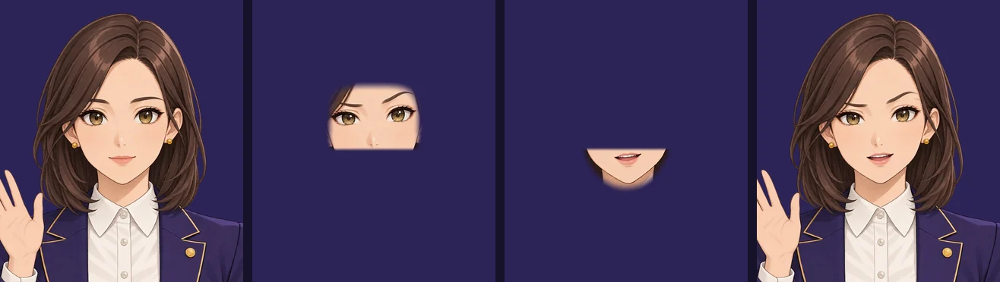
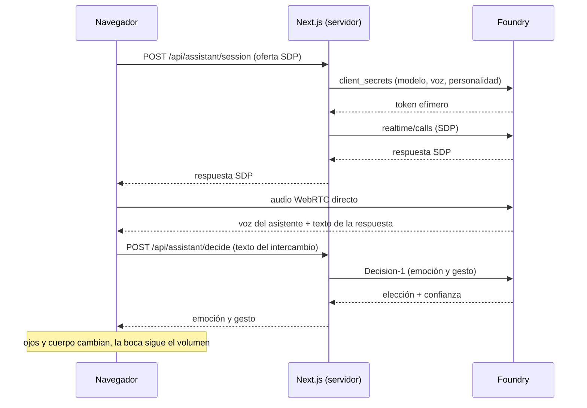
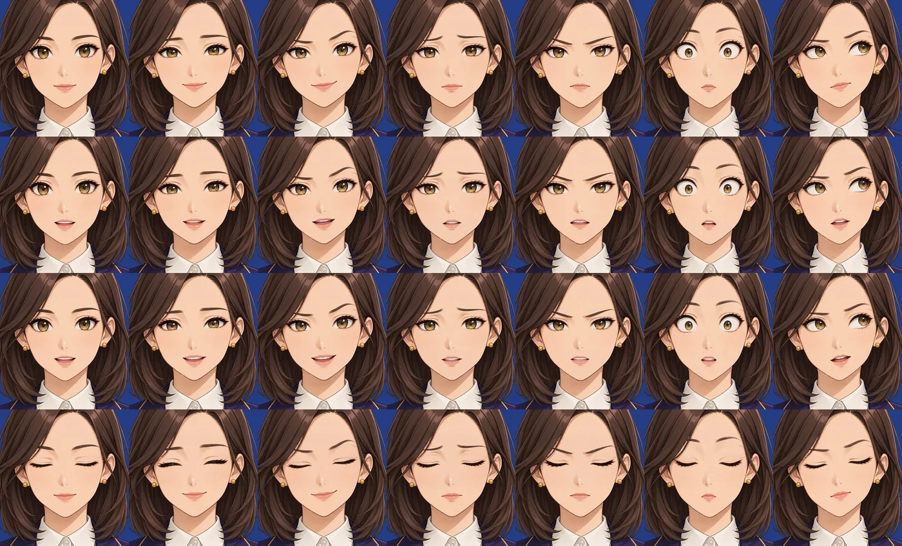

# Teams Assistant

Asistente de voz en tiempo real con un avatar 2D animado, hecho para vivir como pestaña personal de Microsoft Teams y también en el navegador. El avatar habla, mueve la boca con su voz, parpadea, y cambia de expresión y de gesto según lo que dice.



Es de marca blanca: el nombre del asistente, los textos, los colores, la tipografía, el logo, la personalidad y el propio avatar viven en una carpeta de marca, fuera del código. La que viene incluida se llama Ada.

Todo corre sobre un recurso de Microsoft Foundry con tres despliegues:

| Despliegue               | Para qué                                                       |
| ------------------------ | -------------------------------------------------------------- |
| `gpt-realtime-2.1`       | Conversación de voz (Realtime API por WebRTC)                  |
| `Decision-1`             | Elige la emoción y el gesto del avatar entre opciones cerradas |
| `gpt-image-2.5-sunburst` | Genera los sprites del personaje (una sola vez)                |

Documentación relacionada:

- [docs/como-se-construyo.md](docs/como-se-construyo.md): bitácora con todos los pasos, los problemas que aparecieron y cómo se resolvieron, en el código y en lo visual.
- [brands/README.md](brands/README.md): cómo crear tu propia marca.
- [CLAUDE.md](CLAUDE.md): reglas del proyecto para quien lo modifique.

## Cómo funciona

```
Teams / navegador ──▶ Next.js (app + API) ──▶ Foundry
        ▲                                        │
        └────────── audio WebRTC directo ◀───────┘
```

El servidor nunca toca el audio: abre la llamada y se aparta. El modelo de conversación tampoco decide la cara: de eso se encarga un clasificador aparte.



Cuatro ideas sostienen el diseño:

1. **El token efímero y los endpoints de Foundry no salen del servidor.** El navegador solo manda su oferta SDP.
2. **La emoción la elige `Decision-1`, no el modelo de voz.** El texto de la respuesta llega antes que su audio, así que se pide una decisión al cerrarse la primera frase y otra con el texto completo. Una decisión fallida nunca corta la conversación: se queda en neutral.
3. **El avatar son tres capas independientes** (cuerpo, ojos, boca). La boca sigue moviéndose aunque cambie la emoción o haya un gesto en curso.
4. **El código no conoce ninguna marca.** Todo lo que distingue a una está en `brands/<id>/`.

## Estructura

```
app/
  page.tsx                    escenario del asistente (requiere sesión)
  login/page.tsx              entrada: Microsoft y usuario de pruebas
  api/auth/…                  session, login, callback, test-login, logout
  api/assistant/session           abre la llamada (token efímero + SDP)
  api/assistant/decide            Decision-1: emoción y gesto
  brand-assets/[...path]      sirve el logo y los sprites de la marca activa
brands/
  default/                    marca blanca: brand.json, avatar.json y sprites
components/
  brand-provider.tsx          marca activa para la interfaz
  session-provider.tsx        puerta de sesión y SSO de Teams
  assistant/                  escenario, avatar, conversación, panel de depuración
lib/
  brand.ts                    carga y valida la marca activa
  auth/                       sesión, validación de Entra, login web
  foundry/                    autenticación y endpoints de Foundry
  assistant/
    expressions.ts            tablas cerradas de emociones y gestos
    decision.ts               cliente de Decision-1
    emotion-director.ts       cuándo se pregunta y cuándo cambia la cara
    use-assistant-call.ts         la llamada WebRTC
    lipsync.ts                volumen de la voz → apertura de la boca
scripts/                      prueba de humo, sprites, registro de Entra, paquete de Teams
teams-app/                    plantilla del manifest de Teams
tests/                        vitest
```

## Desarrollo local

Requisitos: Node 22 o superior, pnpm 10 y `az login` con una cuenta que tenga un rol de datos sobre el recurso de Foundry (por ejemplo "Cognitive Services User").

```powershell
pnpm install
```

```powershell
Copy-Item .env.example .env
```

Pon en `.env` el endpoint de tu recurso de Foundry y un `ASSISTANT_SESSION_SECRET` de 32 caracteres o más. Después comprueba que Foundry responde y arranca:

```powershell
pnpm smoke:foundry
```

```powershell
pnpm dev
```

Abre http://localhost:3000. Con `ASSISTANT_TEST_LOGIN_ENABLED=true` aparece el botón "Entrar como usuario de pruebas".

- `?debug=1` muestra el panel de depuración: fuerza emociones y gestos, y lista cada decisión de `Decision-1` con su confianza y latencia.
- "Escribirle sin micrófono" abre la llamada sin pedir el micrófono: el asistente habla y tú escribes.

### Comandos

| Comando                | Qué hace                                                           |
| ---------------------- | ------------------------------------------------------------------ |
| `pnpm dev`             | Servidor de desarrollo                                             |
| `pnpm build`           | Compilación de producción (Next.js standalone)                     |
| `pnpm test`            | Tests con vitest                                                   |
| `pnpm typecheck`       | Comprobación de tipos                                              |
| `pnpm lint`            | ESLint                                                             |
| `pnpm format`          | Prettier                                                           |
| `pnpm smoke:foundry`   | Comprueba autenticación, `Decision-1` y el token realtime          |
| `pnpm decide "texto"`  | Pregunta a `Decision-1` por una frase; sin argumentos usa ejemplos |
| `pnpm avatar:generate` | Genera o reprocesa los sprites (llama al modelo de imagen)         |
| `pnpm entra:register`  | Crea o actualiza el registro de app en Entra ID (cambia el tenant) |
| `pnpm teams:package`   | Arma el paquete de Teams de la marca activa                        |

### Variables de entorno

Todas están comentadas en [.env.example](.env.example).

| Variable                       | Para qué                                                                     |
| ------------------------------ | ---------------------------------------------------------------------------- |
| `FOUNDRY_ENDPOINT`             | Recurso de Foundry; vale también la URL del proyecto (solo se usa el origin) |
| `FOUNDRY_API_KEY`              | `entra` usa un token de Entra ID; otro valor se envía como `api-key`         |
| `MODEL_REALTIME`               | Despliegue de voz                                                            |
| `MODEL_DECISION`               | Despliegue de `Decision-1`                                                   |
| `MODEL_IMAGE`                  | Despliegue del modelo de imagen                                              |
| `MODEL_REALTIME_TRANSCRIBE`    | Opcional: transcripción de lo que dice el usuario                            |
| `ASSISTANT_BRAND`              | Marca activa: una carpeta de `brands/`. Por defecto, `default`               |
| `ASSISTANT_SESSION_SECRET`     | Secreto de la cookie de sesión (32 caracteres o más)                         |
| `ASSISTANT_TEST_LOGIN_ENABLED` | `true` activa la entrada de pruebas; se ignora en producción                 |
| `ASSISTANT_PUBLIC_URL`         | URL pública para el login web                                                |
| `ASSISTANT_COOKIE_CROSS_SITE`  | `true` para cookies dentro del iframe de Teams                               |
| `ENTRA_*`                      | Registro de app: tenant, client id, App ID URI y secreto                     |
| `ASSISTANT_PUBLIC_FQDN`        | Host público que usa el manifest de Teams                                    |
| `ALLOWED_FRAME_ANCESTORS`      | Quién puede embeber la app; vacío = dominios de Teams y Microsoft 365        |

## Marcas

Una marca es una carpeta dentro de `brands/`:

```
brands/<id>/
  brand.json        nombre del asistente, textos, colores, tipografía, logo, personalidad, Teams
  avatar.json       prompt del personaje y máscara de la cara
  public/           lo que ve el navegador: logo y avatar/*.webp
  work/             originales del modelo de imagen (git lo ignora)
```

La marca activa se elige con `ASSISTANT_BRAND`. Se lee del disco en cada petición, así que cambiarla no requiere recompilar.

| Qué define `brand.json` | Dónde se ve                                                          |
| ----------------------- | -------------------------------------------------------------------- |
| `assistant`             | Título, botones, estados y nombre en la conversación                 |
| `texts`                 | Frases de la entrada y del escenario                                 |
| `colors`                | Fondo, acento, líneas y aura (variables CSS)                         |
| `font`                  | Tipografía (`manrope` o `montserrat`)                                |
| `logo`                  | Encabezado y entrada; sin logo se muestra el nombre del asistente    |
| `scene`                 | Suelo del escenario (`grid`, `checker`, `none`) y símbolos al pensar |
| `persona` y `voice`     | Quién es el asistente y con qué voz habla                            |
| `teams`                 | Nombres, descripciones y color del paquete de Teams                  |

**Solo `brands/default/` se sube a git.** Cualquier otra carpeta de `brands/` queda ignorada, de modo que la marca de una organización (nombre, logo, colores, avatar) vive en tu máquina y no en el repositorio. Un test lo comprueba. Los pasos para crear una están en [brands/README.md](brands/README.md).

## Entrada

| Forma              | Cuándo                                                                                 |
| ------------------ | -------------------------------------------------------------------------------------- |
| SSO de Teams       | Dentro de Teams, sin pantallas: `getAuthToken()` y validación del token en el servidor |
| Microsoft (OAuth)  | En el navegador: código de autorización + PKCE                                         |
| Entrada de pruebas | `ASSISTANT_TEST_LOGIN_ENABLED=true` y fuera de producción: usuario simulado            |

Las tres terminan en la misma cookie de sesión (`assistant_session`, JWT HS256, HttpOnly), que nunca contiene tokens de Microsoft. Apagar la entrada de pruebas invalida al momento las sesiones que emitió, y con `NODE_ENV=production` no existe.

### Registro en Entra ID

```powershell
pnpm entra:register <FQDN> "Teams Assistant (dev)" --secret
```

El script crea o actualiza el registro de app (scope `access_as_user`, clientes de Teams y Microsoft 365 preautorizados, redirect URIs) e imprime las variables para `.env`. Cambia tu tenant: revísalo antes de ejecutarlo.

## Emociones y gestos

Son tablas cerradas en [lib/assistant/expressions.ts](lib/assistant/expressions.ts), comunes a todas las marcas. La etiqueta de cada fila es lo que lee `Decision-1`.

| Emoción      | Cuándo la elige                                 |
| ------------ | ----------------------------------------------- |
| `neutral`    | Información sin carga emocional                 |
| `happy`      | Saludos, agradecimientos, felicitaciones        |
| `fun`        | Humor, complicidad                              |
| `sad`        | Empatía ante una mala noticia                   |
| `angry`      | Firmeza ante algo indebido                      |
| `surprised`  | Asombro                                         |
| `thoughtful` | Cuando sopesa opciones; también mientras piensa |

| Gesto                           | Cómo se anima                                  |
| ------------------------------- | ---------------------------------------------- |
| `nod`, `tilt`                   | Movimiento CSS de toda la figura               |
| `wave`, `think`, `point`, `bow` | Pose de brazos dibujada, más un movimiento CSS |

Para afinar las etiquetas, `pnpm decide` muestra qué elige el modelo con una batería de frases. Añadir una emoción es añadir una fila, generar sus cuatro frames en cada marca y repetir el posproceso.

## Avatar

Los sprites de cada marca viven en `brands/<id>/public/avatar/` y se generan con:

```powershell
pnpm avatar:generate base
```

```powershell
pnpm avatar:generate frames
```

- `base` crea la imagen de referencia (`brands/<id>/work/raw/base.png`) con el prompt de `avatar.json`. Revísala antes de seguir: todo lo demás sale de ella.
- `frames` crea 7 emociones × 4 frames (boca cerrada, media, abierta y parpadeo) y 4 poses de gesto. Es reanudable.
- `--brand=<id>` elige la marca (por defecto, la de `ASSISTANT_BRAND`). `--only=happy-open,pose-wave` rehace esos frames, `--force` regenera lo existente y `process` repite solo el posproceso, sin llamar al modelo.

El avatar se dibuja en tres capas independientes, para que ninguna animación pise a otra:

| Capa         | Qué cambia                                                  | Archivos                                |
| ------------ | ----------------------------------------------------------- | --------------------------------------- |
| Cuerpo       | La pose normal o la de un gesto (solo se mueven los brazos) | `body-base`, `body-wave`…               |
| Ojos y cejas | La emoción y el parpadeo                                    | `eyes-happy`, `eyes-happy-blink`…       |
| Boca         | La emoción y la apertura, según el volumen de la voz        | `mouth-happy-closed`, `-half`, `-open`… |

Los ojos y la boca son recortes de la cara con el borde difuminado que se colocan sobre el cuerpo. La máscara de la cara y la línea que separa ojos y boca están en `avatar.json` (`face`). Cada personaje tiene la cara en un sitio distinto, así que hay que medirla sobre su imagen base y revisar las dos hojas que deja el posproceso en `brands/<id>/work/`:

- `faces-sheet.png`: caras ampliadas, para ver cejas, ojos y boca de cerca.
- `contact-sheet.png`: cuerpo entero y poses.

La máscara tiene que cubrir por completo las cejas levantadas: si se queda corta, se ven dos cejas a la vez. Mientras una marca no tenga sprites, la app dibuja una figura provisional en SVG con sus colores.



## Teams

1. Publica la app en un host HTTPS (o usa un túnel, por ejemplo `devtunnel host -p 3000 --allow-anonymous`).
2. Ejecuta `pnpm entra:register <FQDN> --secret` y copia las variables a `.env`. Pon también `ASSISTANT_COOKIE_CROSS_SITE=true` y `ASSISTANT_PUBLIC_URL=https://<FQDN>`.
3. Ejecuta `pnpm teams:package` y sube `teams-app/<marca>.zip` en Teams (Aplicaciones, Administrar tus aplicaciones, Cargar una aplicación).

El manifest pide `devicePermissions: ["media"]` para el micrófono. La app manda `frame-ancestors` con los dominios de Teams y Microsoft 365. Los nombres, las descripciones y los iconos del paquete salen de la marca activa.

## Despliegue

Todavía no hay despliegue. El `Dockerfile` genera la imagen de producción (Next.js standalone) con la marca que se indique en `--build-arg ASSISTANT_BRAND=<id>`. El camino previsto es Azure Container Apps con identidad administrada: rol de datos sobre el recurso de Foundry, `FOUNDRY_API_KEY=entra` y los secretos en Key Vault. En producción la entrada de pruebas queda desactivada.

## Estado

Probado en local:

- Entrada de pruebas, llamada de voz escribiendo, respuesta hablada del asistente y lip-sync.
- `Decision-1` eligiendo emoción y gesto, con latencias de 200 a 600 ms.
- Las tres capas del avatar moviéndose a la vez.
- Cambio de marca con `ASSISTANT_BRAND`, sin recompilar.
- Tests, tipos, lint y compilación de producción.

Escrito pero sin probar de extremo a extremo:

- La conversación hablada con micrófono (el navegador de pruebas no da acceso al micrófono).
- El login con Microsoft, el SSO de Teams y el paquete de Teams: dependen de crear el registro en Entra ID.

## Limitaciones conocidas

- Sin un despliegue de transcripción (`MODEL_REALTIME_TRANSCRIBE`), los turnos hablados del usuario salen como "Mensaje de voz" y `Decision-1` decide solo con el texto del asistente.
- No hay base de datos: cada llamada empieza de cero y no se guarda historial ni consumo.
- La llamada dura como máximo 20 minutos y se cierra tras 3 minutos sin actividad.
