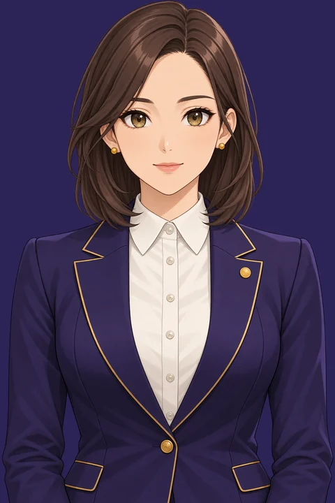
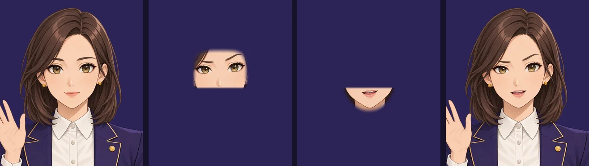
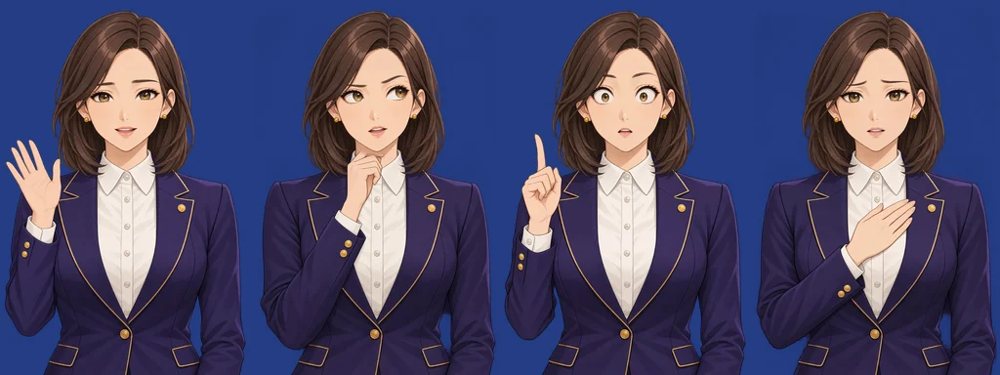
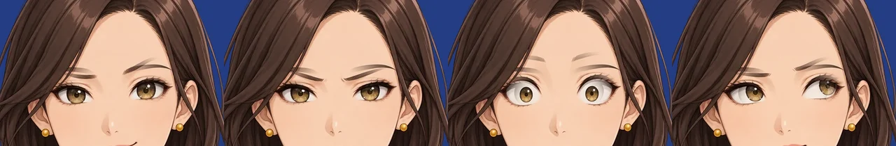
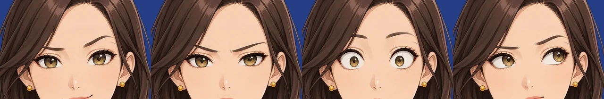
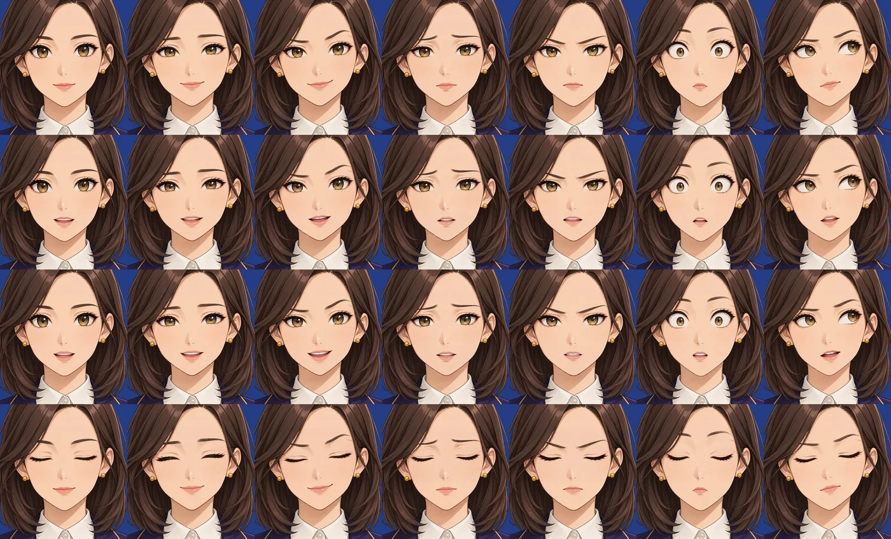

# Cómo se construyó

Bitácora de todo lo que se hizo para que el asistente funcionara, en el orden en que pasó: las decisiones, los pasos del código, los pasos de lo visual, los problemas que aparecieron y cómo se resolvió cada uno. El [README](../README.md) explica cómo usar el proyecto; este documento explica por qué quedó así.

## 1. Punto de partida

El encargo: un asistente de IA para Microsoft Teams sobre Microsoft Foundry, con entrada por OAuth de Microsoft y una entrada de pruebas, una conversación de voz en tiempo real y un avatar 2D con animaciones y emociones. El avatar debía generarse con un modelo de imagen, y las emociones debían gestionarse como en los VTubers con IA: con un modelo de decisión aparte.

Había dos referencias:

| Referencia                           | Qué se tomó                                                                                  |
| ------------------------------------ | -------------------------------------------------------------------------------------------- |
| Una app previa de voz en tiempo real | La llamada WebRTC, la cookie de sesión, el SSO de Teams, el login web y el manifest de Teams |
| Un proyecto de VTuber con IA         | El patrón de emociones: un modelo aparte elige entre opciones cerradas, después de responder |

Decisiones que se cerraron antes de escribir código:

| Tema               | Decisión                                                         |
| ------------------ | ---------------------------------------------------------------- |
| Dónde vive         | Pestaña personal de Teams; también funciona en navegador         |
| Qué hace           | Asistente general, sin herramientas ni datos corporativos        |
| Entrada de pruebas | Un botón activado por variable de entorno, con usuario simulado  |
| Animación          | Emociones y gestos                                               |
| Entra ID           | Un script que ejecuta el dueño del tenant; la app arranca sin él |
| Alcance            | Local más paquete de Teams; sin desplegar a Azure                |
| Persistencia       | Sin base de datos                                                |

El proyecto nació con la marca de una organización concreta. Más adelante se separó la marca del código (sección 5) y lo que se publica es la versión de marca blanca.

## 2. Lo que se comprobó antes de construir

Tres cosas se verificaron contra el recurso real, porque de ellas dependía el diseño.

**Qué había desplegado.** `az cognitiveservices account deployment list` mostró un modelo de voz en tiempo real, uno de imagen y `Decision-1` (modelo `Microsoft-Decision-1`). Dos consecuencias: el modelo de decisión era un despliegue de Foundry y no uno local, y no había ningún modelo de transcripción.

**El contrato de `Decision-1`.** La documentación publicada describía la versión 1.1, así que se probó el despliegue antes de depender de él. `pnpm smoke:foundry` confirmó la ruta y la forma de la respuesta:

```
POST {recurso}/providers/microsoft/v1/systemone
{ "model": "Decision-1", "state": "...", "questions": { "emotion": { "type": "choice", "instructions": "...", "criteria": { ... } } } }

→ { "answers": { "emotion": { "type": "choice", "choice": "happy", "confidence": 0.99, "probabilities": { ... } } } }
```

**La llamada realtime.** La misma prueba crea un token efímero en `/openai/v1/realtime/client_secrets` y confirmó que el modelo de voz acepta la configuración de sesión prevista.

## 3. El código, paso a paso

### 3.1 Andamiaje

Next.js 16, React 19, TypeScript estricto, Tailwind 4 y pnpm. Foundry se llama con `fetch`, sin SDK.

### 3.2 Foundry

- `lib/foundry/auth.ts`: con `FOUNDRY_API_KEY=entra` usa `DefaultAzureCredential` (en local, la sesión de `az login`); con otro valor manda la cabecera `api-key`. El token se guarda en caché.
- `lib/foundry/endpoints.ts`: deriva todas las URL del origin de `FOUNDRY_ENDPOINT`. Acepta la URL del proyecto porque solo usa el origin.
- `scripts/smoke-foundry.ts`: la prueba de humo de la sección anterior.

### 3.3 Entrada y sesión

1. **Cookie de sesión** (`lib/auth/session.ts`): un JWT HS256 propio, HttpOnly, de 8 horas, que solo lleva el perfil. Dentro del iframe de Teams la cookie es de terceros, así que usa `SameSite=None; Secure; Partitioned`.
2. **SSO de Teams** (`lib/auth/entra.ts`): valida el token contra las claves del tenant y exige emisor, audiencia, tenant y el scope `access_as_user`.
3. **Login web** (`lib/auth/login.ts`): código de autorización con PKCE; el estado viaja en una cookie firmada de 10 minutos.
4. **Entrada de pruebas**: `ASSISTANT_TEST_LOGIN_ENABLED=true` muestra el botón y crea una sesión marcada como de pruebas. Esa marca hace que la sesión deje de valer en cuanto se apaga la variable, y en producción nunca vale.
5. **Puerta de sesión** (`components/session-provider.tsx`): primero la cookie, luego el SSO de Teams si la app está dentro de un iframe, y si no, la página de entrada.

Las rutas que cambian estado comprueban que la petición viene del mismo origen.

### 3.4 La llamada de voz

`app/api/assistant/session` recibe la oferta SDP del navegador, crea el token efímero con la sesión fijada en el servidor (modelo, voz, detección de turnos `semantic_vad` y la personalidad del asistente) y entrega la oferta a Foundry. Devuelve la respuesta SDP. A partir de ahí el audio va directo entre el navegador y Azure.

`lib/assistant/use-assistant-call.ts` maneja la llamada en el navegador, con dos detalles:

- **Llamada sin micrófono.** Si el usuario lo pide, la conexión se abre en modo solo recepción: el asistente habla y el usuario escribe. Es una opción de accesibilidad, y fue lo que permitió probar todo en un navegador sin acceso al micrófono.
- **Eventos hacia el director de emociones**, que se explica abajo.

El prompt le pide turnos de una a tres frases y le prohíbe describir sus gestos o escribir acotaciones: su cara se anima por separado.

### 3.5 Emociones con `Decision-1`

El principio: **el modelo que conversa no decide la cara**. No hay etiquetas en el texto ni nada que parsear.

- `lib/assistant/expressions.ts` tiene las tablas cerradas: siete emociones y siete gestos. La etiqueta de cada fila es lo que lee el clasificador, y la primera fila es el valor por defecto.
- `lib/assistant/decision.ts` arma el estado con el último intercambio (`User: …` y `<nombre> (character): …`, recortado por el principio a 2400 caracteres) y hace dos preguntas en una sola petición: emoción y gesto.
- Si la respuesta no es válida, hay un error o pasan 2,5 segundos, devuelve `neutral` y `none`. La conversación nunca se rompe por una decisión.

### 3.6 El director de emociones

En un VTuber clásico la decisión se toma cuando el texto ya está completo. En tiempo real eso llegaría tarde, pero hay una ventaja: el texto de la respuesta llega antes que su audio. `lib/assistant/emotion-director.ts` la aprovecha:

1. Al cerrarse la primera frase (o a los 80 caracteres) pide una decisión y aplica la emoción. El audio apenas empieza.
2. Con el texto completo pide otra: emoción final y gesto. El gesto se reproduce una sola vez.
3. Descarta las decisiones de una respuesta anterior o interrumpida.
4. Con una confianza menor de 0,4 conserva la emoción que había.
5. Cuando el asistente deja de hablar, mantiene la expresión 5 segundos y vuelve a neutral.

No depende de React ni del navegador, y por eso se prueba con temporizadores falsos.

### 3.7 Teams, Entra y empaquetado

- `teams-app/manifest.json`: plantilla de pestaña personal con SSO y `devicePermissions: ["media"]` para el micrófono.
- `next.config.ts`: cabecera `frame-ancestors` con los dominios de Teams y Microsoft 365.
- `scripts/register-entra.mjs`: crea el registro, el scope y preautoriza los clientes de Teams. No se ejecutó: cambia el tenant y eso lo decide su dueño.
- `scripts/make-teams-package.mjs` y `Dockerfile`: listos, sin usar todavía.

## 4. Lo visual, paso a paso

### 4.1 Escenario

El escenario es un degradado con un suelo en perspectiva hecho con CSS y el avatar encima. Antes de tener imágenes se construyó una figura provisional en SVG que respondía a las mismas señales (emoción, boca, parpadeo). Sirvió para probar la llamada y las decisiones sin esperar al personaje.

### 4.2 La imagen base

Todo el personaje sale de una sola imagen de referencia, generada a 1024×1536 con fondo transparente.



Con el primer personaje que se hizo, la primera versión salió con el estilo correcto pero con escote, que no encajaba con un asistente profesional. Se cambió el prompt (blusa abotonada hasta el cuello, proporciones sobrias) y se generó de nuevo. Esa indicación quedó en todos los prompts de personaje.

### 4.3 Los frames

Cada frame es una edición de la base con la base como imagen de referencia y una instrucción del tipo "cambia solo esto, mantén todo lo demás igual":

- Cada emoción sale de la base.
- La boca media, la abierta y el parpadeo de cada emoción salen de la versión con la boca cerrada de esa emoción.
- Cada pose de gesto sale de la base.

En total, 27 frames de emoción y 4 poses por personaje. Cada imagen tarda entre 30 y 60 segundos, de una en una.

### 4.4 Primer diseño: una imagen por estado

La primera versión guardaba una imagen de cuerpo entero por cada combinación de emoción y boca, y otra por cada gesto. Para que nada temblara al cambiar de imagen, el posproceso conservaba de cada frame solo la región de la cara y dejaba el resto idéntico a la base.

Funcionaba mientras solo cambiaba una cosa a la vez, y ahí estaba el defecto.

### 4.5 Segundo diseño: tres capas

El problema se vio al usarlo: como la boca estaba "pegada" al cuerpo, cualquier otra animación la pisaba. Cambiar de emoción o lanzar un gesto sustituía la imagen entera, y con un gesto la boca solo tenía dos estados.

La solución fue separar el avatar en tres capas que cambian por su cuenta:



| Capa         | Imágenes | Qué la mueve                                         |
| ------------ | -------- | ---------------------------------------------------- |
| Cuerpo       | 5        | El gesto: pose normal o una pose de brazos           |
| Ojos y cejas | 14       | La emoción y el parpadeo automático                  |
| Boca         | 21       | La emoción y la apertura, según el volumen de la voz |

No hizo falta generar imágenes nuevas para la cara: los mismos frames se recortan de otra manera. La mitad superior de la cara va a la capa de ojos y la inferior a la de boca, cada una con el borde difuminado.

Los gestos sí cambiaron. Con capas, la cara se dibuja siempre en el mismo sitio, así que **la cabeza no puede moverse en las poses**. Las cuatro poses se generan con una instrucción específica: solo se mueven los brazos, y nada tapa la cara.

- La pose de pensar pasó de "mano en el mentón" a "mano cerrada justo debajo del mentón".
- La reverencia pasó a ser una mano sobre el pecho, y la inclinación la hace una animación CSS.
- El posproceso fuerza los píxeles de la base en la zona de la cara de cada pose, para garantizar que los recortes encajen.



### 4.6 Las cejas dobles

Con las capas ya funcionando, en algunas expresiones las cejas se sobreponían. Las dos imágenes siguientes reproducen el problema con el avatar de marca blanca.



La causa no estaba en las imágenes sino en la máscara que recorta la cara. Era un óvalo con el borde difuminado muy ancho: solo era opaca hasta el 71 % de su radio. Los extremos de las cejas caían en la zona difuminada, donde el recorte es semitransparente y deja ver la base. Una ceja levantada no coincide con la de la base, así que se veían las dos. Lo mismo dejaba una sombra del ojo abierto en los parpadeos.

Se cambió la forma de la máscara:

| Parámetro        | Antes                   | Después                                  |
| ---------------- | ----------------------- | ---------------------------------------- |
| Forma arriba     | Óvalo                   | Casi rectangular, con esquinas redondas  |
| Alto y ancho     | Ajustados a ojos y boca | Hasta por encima de las cejas levantadas |
| Borde difuminado | 0,03 del alto           | 0,012 del alto                           |



Para no depender de abrir la app, el posproceso genera `faces-sheet.png` con todas las caras ampliadas.

### 4.7 La apertura de la boca

La boca totalmente abierta se había pedido como "un sonido ah" y salió casi como un grito. Se cambió la instrucción: una apertura moderada, de conversación tranquila, sin bajar la mandíbula.



### 4.8 Las animaciones

| Animación             | Cómo se hace                                                                         |
| --------------------- | ------------------------------------------------------------------------------------ |
| Movimiento de la boca | Cada 80 ms se mide el volumen de la voz y se elige cerrada, media o abierta          |
| Parpadeo              | Cada 3 a 6 segundos, durante 130 ms                                                  |
| Respiración           | Animación CSS continua                                                               |
| Escucha               | La figura se acerca un poco                                                          |
| Pensar                | Se inclina, flotan unos símbolos y, si no hay otra emoción, pone cara pensativa      |
| Hablar                | Un rebote leve y un aura que crecen con el volumen                                   |
| Gestos                | Una animación CSS de toda la figura y, en cuatro de ellos, además una pose de brazos |

La boca usa umbrales distintos para abrir y para cerrar. Sin eso tiembla cuando el volumen queda cerca de un umbral.

El movimiento de la figura está repartido en tres contenedores anidados (postura, gesto y respiración) para que una animación no cancele a otra. Con `prefers-reduced-motion` se apagan todas.

## 5. Separar la marca del código

El proyecto empezó con el nombre, los colores, el logo y el personaje de una organización escritos dentro del código, las imágenes y la documentación. Para publicarlo hubo que sacarlos sin perderlos.

### 5.1 Una carpeta por marca

Todo lo que distingue a una marca pasó a `brands/<id>/`:

| Archivo       | Contenido                                                                                 |
| ------------- | ----------------------------------------------------------------------------------------- |
| `brand.json`  | Nombre del asistente, textos, colores, tipografía, logo, suelo, personalidad, voz y Teams |
| `avatar.json` | Prompt del personaje y máscara de la cara                                                 |
| `public/`     | Logo y sprites del avatar                                                                 |
| `work/`       | Originales del modelo de imagen                                                           |

`.gitignore` ignora todo `brands/` salvo `brands/default/`. La marca original se movió a su propia carpeta, que no se versiona, y sigue funcionando igual con `ASSISTANT_BRAND`.

### 5.2 Cómo llega la marca a la app

- `lib/brand.ts` lee y valida `brand.json` en cada petición. Los colores se validan como `#RRGGBB` porque acaban en un estilo en línea.
- `app/layout.tsx` inyecta los colores como variables CSS en `<html>` y elige la tipografía. La hoja de estilos ya no tiene ningún color de marca fijo.
- Un proveedor de contexto pasa a la interfaz solo la parte pública: ni la personalidad ni los datos de Teams llegan al navegador.
- `/brand-assets/…` sirve el logo y los sprites desde la carpeta de la marca activa, y rechaza cualquier ruta que intente salirse de ella. Así cada marca vive en una sola carpeta y no hay que copiar nada a `public/`.
- La personalidad (`persona`) abre el prompt de sistema; las reglas de conversación son comunes.

### 5.3 El avatar de marca blanca

Se generó un personaje nuevo, sin relación con el original, con el mismo procedimiento: imagen base, 27 frames de emoción, 4 poses, y la máscara medida sobre su propia cara. Las instrucciones de emociones, bocas y poses no se tocaron: son las mismas para cualquier personaje.

### 5.4 Qué se revisó para que no se colara nada

- Búsqueda de nombres, dominios, rutas locales, identificadores de tenant y nombres de recursos en todos los archivos versionados.
- El endpoint de ejemplo de `.env.example` pasó a ser un marcador.
- Las imágenes de la documentación se rehicieron con el avatar de marca blanca.
- El área de preparación de git se vació y se volvió a llenar después de mover la marca original, y no había commits previos, así que no queda nada en el historial.
- Un test falla si git rastrea cualquier carpeta de `brands/` que no sea la de marca blanca.
- La compilación de producción también se revisó, y ahí sí había una fuga: ver el siguiente apartado.

### 5.5 La fuga que no estaba en git

Con git limpio, la salida de `pnpm build` seguía llevándose la marca privada. El compilador rastrea las llamadas a `path.join` para decidir qué archivos copia a la salida de producción. Al ver rutas del tipo "una carpeta dentro de `brands/`", "algún `brand.json`" y "algún `public/`", copiaba esos archivos de **todas** las marcas presentes en la máquina. Una imagen Docker construida ahí habría incluido la marca privada, aunque el repositorio no la tuviera.

Tres intentos antes de dar con la solución:

1. Excluir las otras carpetas por nombre en `next.config.ts`. Funcionaba, pero la lista de exclusiones queda escrita dentro de la compilación: el nombre de la marca privada aparecía en la configuración embebida.
2. Excluir con un patrón que no nombrara nada (`!(marca-activa)`). El rastreador no lo respeta.
3. Marcar `process.cwd()` con `turbopackIgnore`. Dejó fuera los originales, pero el compilador seguía deduciendo los otros dos patrones.

Lo que funcionó: construir las rutas de marca sin `path.join` (`runtimePath` en `lib/brand.ts`), porque son rutas que solo existen en tiempo de ejecución, e incluir a propósito únicamente la marca activa con `outputFileTracingIncludes`. Se comprobó buscando el nombre de la marca privada en toda la carpeta `.next`: cero coincidencias.

## 6. Problemas y soluciones

| Síntoma                                                         | Causa                                                                                 | Solución                                                                              |
| --------------------------------------------------------------- | ------------------------------------------------------------------------------------- | ------------------------------------------------------------------------------------- |
| El personaje salió con escote                                   | El prompt no fijaba el vestuario                                                      | Prompt con blusa abotonada y proporciones sobrias; base regenerada                    |
| No se veía la boca ni las emociones                             | Solo existía la imagen base; los demás estados caían a ella                           | Generar todos los frames                                                              |
| La boca se detenía al cambiar de emoción o con un gesto         | La boca estaba dentro de una imagen de cuerpo entero                                  | Tres capas independientes                                                             |
| Con capas, un gesto habría descolocado la cara                  | Las poses movían la cabeza                                                            | Poses solo de brazos y cara de la base forzada en cada pose                           |
| Cejas dobles en algunas expresiones                             | El borde difuminado de la máscara dejaba ver la base                                  | Máscara más cuadrada, más alta y con borde fino                                       |
| Sombra sobre los ojos al parpadear                              | La misma máscara                                                                      | La misma corrección                                                                   |
| Boca abierta exagerada                                          | El prompt pedía una boca muy abierta                                                  | Prompt de apertura moderada                                                           |
| Al cambiar de imagen el personaje se veía translúcido           | Un fundido cruzado entre dos imágenes con transparencia                               | La imagen nueva aparece al instante debajo; la anterior se desvanece encima           |
| El avatar quedaba fuera de la vista al crecer la conversación   | Su columna se estiraba a la altura de la otra                                         | La escena queda fija a la vista en pantallas anchas                                   |
| El saludo sale con cara neutra                                  | El texto de un saludo corto no lleva emoción y el clasificador lo lee así             | Etiquetas afinadas con `pnpm decide`; sigue saliendo neutro (ver sección 7)           |
| Los mensajes escritos dejaban un hueco vacío en la conversación | Se reservaba un hueco para cualquier mensaje del usuario                              | Solo se reserva para mensajes de voz; sin transcripción dice "Mensaje de voz"         |
| No se podía probar la llamada sin micrófono                     | El navegador de pruebas no da acceso al micrófono                                     | Llamada en modo solo recepción                                                        |
| `--only=a,b,c` no generaba nada                                 | PowerShell convierte las comas sin comillas en espacios                               | El filtro acepta comas y espacios                                                     |
| La hoja de contacto fallaba al componer                         | `sharp` redimensiona antes de componer, sin importar el orden de las llamadas         | Componer primero y redimensionar después, en dos pasos                                |
| La marca estaba mezclada con el código                          | Nombre, colores, logo y personaje escritos en componentes, estilos y prompts          | Una carpeta por marca y variables CSS (sección 5)                                     |
| La compilación de producción incluía la marca privada           | El compilador deduce de `path.join` qué archivos copiar y se llevaba todas las marcas | Rutas de marca sin `path.join` e inclusión explícita de la marca activa (sección 5.5) |

## 7. Cómo se verificó

**Foundry.** `pnpm smoke:foundry` pasó contra el recurso real: autenticación con Entra ID, `Decision-1` y token realtime.

**Decisiones.** `pnpm decide` prueba diez intercambios de ejemplo. Estos son ocho:

| Respuesta del asistente                       | Emoción            | Gesto         |
| --------------------------------------------- | ------------------ | ------------- |
| "¡Qué buena noticia, felicidades!…"           | `happy` 100 %      | `nod` 94 %    |
| "Lo siento mucho. Es un golpe duro…"          | `sad` 100 %        | `none` 35 %   |
| "Ciento ochenta."                             | `neutral` 100 %    | `none` 99 %   |
| "¿Qué le dice un semáforo a otro?…"           | `fun` 99 %         | `none` 89 %   |
| "No. Eso sería un error…"                     | `angry` 95 %       | `point` 80 %  |
| "¿En dos días? Eso sí que no me lo esperaba…" | `surprised` 100 %  | `nod` 57 %    |
| "Déjame pensarlo. Hay dos caminos posibles…"  | `thoughtful` 100 % | `think` 100 % |
| "Ha sido un placer. Vuelve cuando quieras."   | `happy` 98 %       | `wave` 74 %   |

Los otros dos son los casos dudosos. El saludo "Hola. ¿En qué puedo ayudarte hoy?" sale `neutral` con 74 %, aunque con el gesto de saludar (91 %): el clasificador lee el texto tal como es, y ese texto no lleva emoción. Una explicación técnica sale `neutral` con 52 %, que es lo esperado.

Dentro de una llamada, cada decisión tardó entre 200 y 600 ms.

**Las capas.** En una llamada real con una respuesta larga se registró cada 100 ms qué imagen mostraba cada capa mientras el asistente hablaba:

| Momento                                          | Cuerpo  | Ojos                       | Boca (cerrada / media / abierta) |
| ------------------------------------------------ | ------- | -------------------------- | -------------------------------- |
| Hablando, sin tocar nada                         | Base    | Neutral, con dos parpadeos | 11 / 17 / 12                     |
| Durante el gesto de saludar                      | Saludar | Neutral                    | 6 / 12 / 4                       |
| Emoción cambiada a sorprendida y gesto de pensar | Pensar  | Sorprendida                | 9 / 9 / 10                       |
| Después del gesto                                | Base    | Sorprendida, con parpadeos | 34 / 43 / 40                     |

La boca alternó sus tres aperturas en todos los momentos, que era justo lo que fallaba con el primer diseño.

**Las marcas.** Con la misma compilación se alternó entre la marca blanca y una marca privada cambiando solo `ASSISTANT_BRAND`: título, tipografía, colores, logo y los 40 sprites cambiaron sin reiniciar. La ruta de archivos de marca devolvió 404 al pedirle `brand.json` o una ruta con `..`.

**Código.** Tests con vitest (sesión, entrada de pruebas, validación de tokens con claves locales, cliente de `Decision-1`, director de emociones, lip-sync y marcas), tipos, ESLint, Prettier y compilación de producción.

## 8. Qué queda sin probar

- **La conversación hablada.** Todas las pruebas de la llamada se hicieron escribiendo, porque el navegador de pruebas no da acceso al micrófono. La detección de turnos y las interrupciones con voz no se han visto funcionando.
- **Microsoft y Teams.** El login web, el SSO y el paquete de Teams están escritos y cubiertos por tests, pero no se han probado contra un registro real de Entra ID.
- **Despliegue.** El `Dockerfile` no se ha construido ni desplegado.

## 9. Cómo repetirlo desde cero

Para crear una marca con su propio personaje, sigue [brands/README.md](../brands/README.md). Para rehacer los sprites de una que ya existe:

1. Ajusta `basePrompt` en `brands/<id>/avatar.json` y ejecuta `pnpm avatar:generate base --brand=<id> --force`.
2. Revisa `brands/<id>/work/base-preview.png`. Todo lo demás sale de esa imagen, así que conviene repetir este paso hasta que convenza.
3. Mide en la base dónde queda la cara y ajusta `face` en `avatar.json`: centro, ancho, alto hacia arriba y hacia abajo, y la línea entre la nariz y la boca. Los valores son fracciones del alto y del ancho de la imagen.
4. Ejecuta `pnpm avatar:generate frames --brand=<id> --force`. Son 31 imágenes y tarda entre 20 y 30 minutos.
5. Revisa `faces-sheet.png` y `contact-sheet.png` en `brands/<id>/work/`. Cejas dobles o sombras en los ojos significan que la máscara se queda corta. Una costura visible bajo la nariz significa que hay que mover la línea entre ojos y boca.
6. Si solo cambiaste la máscara, `pnpm avatar:generate process --brand=<id>` repite el posproceso sin llamar al modelo.
7. Para rehacer frames sueltos: `pnpm avatar:generate frames --brand=<id> "--only=happy-open,pose-wave" --force`.

El script llama al modelo de imagen en cada frame: un avatar completo son 32 imágenes.
